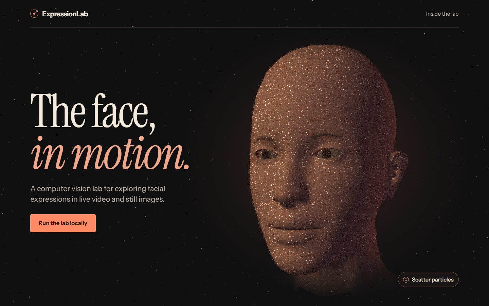
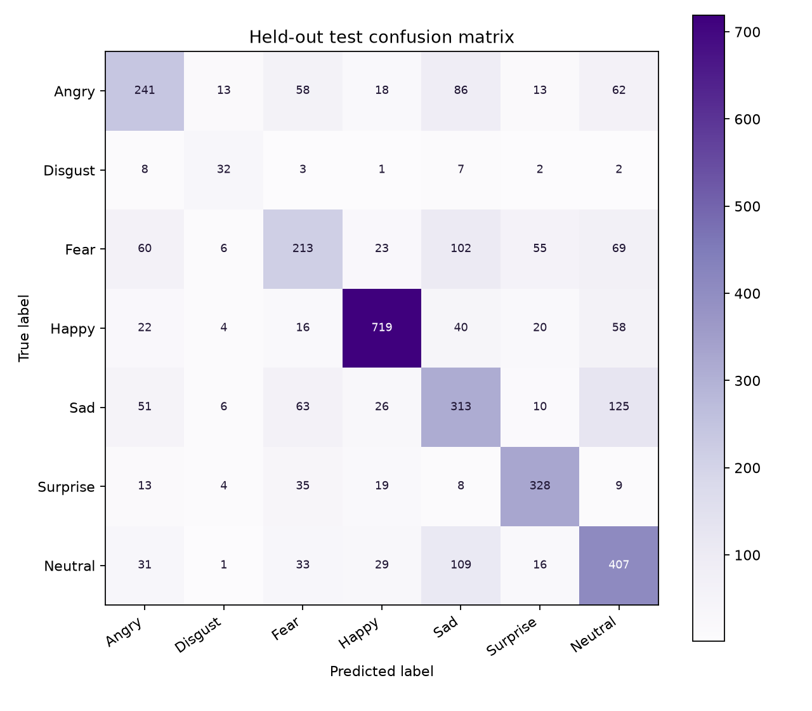
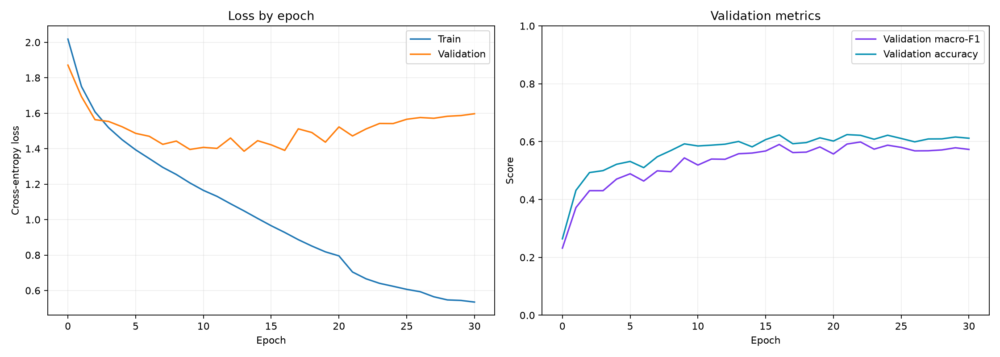

# ExpressionLab — Facial Expression Recognition

[](https://aditya-garg02.github.io/facial-expression-lab/)

An end-to-end, privacy-first computer vision project that classifies **visible facial expressions** into seven FER-2013 categories. It includes a residual CNN, a reproducible training pipeline, evaluation reports, Grad-CAM visualizations, and a local Streamlit app for images and live camera frames.

> This model estimates dataset labels from pixels. It does not know a person's internal emotional state, intent, personality, or wellbeing. Do not use it for hiring, grading, surveillance, access decisions, or other consequential decisions.

[Open the interactive 3D preview](https://aditya-garg02.github.io/facial-expression-lab/). GitHub Pages hosts the sculpture and benchmark preview. Follow the quick start below for live camera, image analysis, and Grad-CAM using the included checkpoint.

## Features

- A custom residual CNN trained from FER-2013, with configurable epochs, batch size, and augmentation.
- Reproducible train/validation/test split handling, class-weighted loss, early stopping, and best-checkpoint saving.
- Evaluation outputs: accuracy, macro-F1, per-class precision/recall/F1, confusion matrix, and training curves.
- Per-face predictions with seven-class charts, top-two margin, optional Grad-CAM, and uncertainty-aware messaging.
- OpenCV YuNet face detection for images and video, with seven-class webcam scores smoothed per tracked face.
- A full-viewport particle field that responds to pointer movement, taps, and drags.
- Model report page with held-out accuracy, macro-F1, per-class scores, confusion matrix, and training curves.
- Local inference: photos and camera snapshots stay on your machine; no API calls or image uploads.
- Clear dataset, model, and responsible-use documentation.

## Stack

Three.js · Vite · Python · PyTorch · OpenCV · Streamlit · Plotly · scikit-learn

## Quick start

Use Python 3.10 or 3.11 and Node.js 22.12 or later. From the directory containing `app.py`:

```bash
python -m venv .venv
# Windows PowerShell: .venv\Scripts\Activate.ps1
# macOS/Linux: source .venv/bin/activate
python -m pip install --upgrade pip
pip install -r requirements.txt
npm ci
```

Start the 3D site and the Streamlit lab together:

```bash
npm run dev
```

Open [ExpressionLab](http://127.0.0.1:4173/) and select **Get started**. The launcher also serves the lab directly at [`/lab/`](http://127.0.0.1:4173/lab/). It looks for a Python interpreter in `.venv` here or in the parent directory. Set `EXPRESSIONLAB_PYTHON` if your virtual environment lives elsewhere. Set `EXPRESSIONLAB_PORT` if port 4173 is busy.

To serve the built site locally, run `npm run build` followed by `npm start`.

### Model setup

The lab uses `artifacts/best_model.pt`. If you already have this checkpoint, you can open the lab immediately. To train a checkpoint:

Download the FER-2013 CSV from the Kaggle FER-2013 dataset page and place it at `data/fer2013.csv` (or pass a different path to the trainer). The expected columns are `emotion`, `pixels`, and optionally `Usage`. The pixel column contains 48×48 grayscale pixels separated by spaces. Respect the dataset's license and terms.

Train and evaluate:

```bash
python train.py --csv data/fer2013.csv --epochs 35 --batch-size 128
```

The best validation checkpoint is saved under `artifacts/best_model.pt`. Training history, test metrics, confusion matrix, and class metrics are written to `artifacts/` as JSON/CSV/PNG files. Training prints the selected device and progress by epoch.

The supplied checkpoint also has a matching `artifacts/inference_profile.json`. Still-image analysis averages the original and horizontally mirrored views. Webcam analysis uses one view with temporal smoothing for responsive playback. The matching profile supplies temperature scaling fitted on the validation split. A freshly trained checkpoint uses its own scores unless it has a matching profile.

To reproduce the profile on FER-2013's official splits:

```bash
python benchmark_inference.py --output artifacts/inference_profile.json
```

To launch Streamlit directly:

```bash
streamlit run app.py
```

Use the **Live lab**, **Image analysis**, and **Model report** tabs. For camera use, allow the browser permission prompt. Frames are processed by the local Python process and are not recorded by the app. A checkpoint must exist at `artifacts/best_model.pt`; the app shows a clear setup message if it does not.

## Training options

```bash
python train.py --help
```

Useful options include `--epochs`, `--batch-size`, `--learning-rate`, `--seed`, `--output-dir`, and `--num-workers`. If `Usage` exists, rows marked `Training`, `PublicTest`, and `PrivateTest` are kept in their official partitions. Otherwise, the script makes deterministic stratified train/validation/test splits.

The opt-in `--recipe robust` uses stronger augmentation and an exponential moving average for checkpoint selection. Pair `--warm-start artifacts/best_model.pt` with a different `--output-dir` to evaluate a candidate without replacing the active checkpoint.

## Project structure

```text
facial-expression-lab/
├── app.py                 # Local image/camera inference and Grad-CAM
├── index.html             # Landing page
├── src/                   # Landing styles and interactive 3D scene
├── server.mjs             # Local site and Streamlit launcher
├── model.py               # Residual CNN and preprocessing helpers
├── train.py               # Training, validation, test evaluation
├── requirements.txt
├── .gitignore
├── data/                  # Put FER-2013 CSV here (not committed)
└── artifacts/             # Generated checkpoint and evaluation outputs
```

## Evaluation and reporting



The diagonal shows correct classifications. Off-diagonal cells show which expressions the checkpoint confuses.



The held-out test report is emitted after training. Report **macro-F1 and per-class recall** alongside accuracy because the categories are imbalanced. Do not present a single accuracy value without the split, dataset, and class-wise results. FER-2013 is a small, low-resolution, in-the-wild dataset with known demographic and label limitations; test performance does not establish performance on a different camera, population, or context.

## Next steps for a stronger research version

1. Compare this CNN with a transfer-learning baseline and publish both results.
2. Add cross-dataset evaluation (for example, train on FER-2013 and evaluate on a separately licensed dataset).
3. Measure calibration and subgroup performance where ethically sourced metadata permits.
4. Add a model card with the exact checkpoint, dataset version, split, limitations, and intended use.

## Suggested portfolio description

> Built a privacy-first facial-expression classification system using PyTorch and Streamlit. Implemented a residual CNN training pipeline with class imbalance handling, stratified evaluation, macro-F1 reporting, confusion-matrix analysis, and Grad-CAM visual explanations; packaged local image and webcam-snapshot inference with confidence-aware messaging.

## License

Source code in this project is provided under the MIT License. FER-2013 and any other datasets you use have their own terms; review them separately before redistribution or commercial use.
